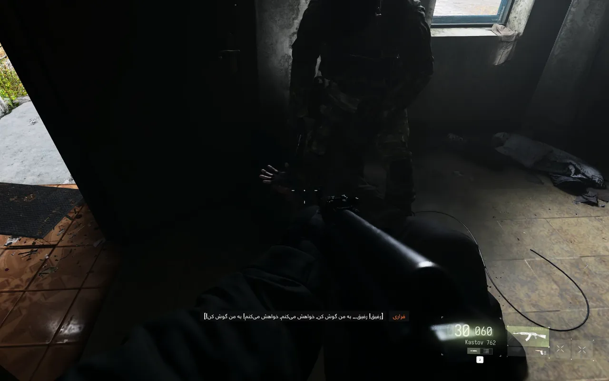

# فارسی‌ساز Call of Duty: Modern Warfare 4

مخزن رسمی پروژه و دریافت نسخه‌های جدید: [GitHub — call-of-duty-mw4-persian-farsi](https://github.com/e3ang/call-of-duty-mw4-persian-farsi)

ترجمه و زیرنویس فارسی بخش داستانی **کالاف دیوتی مدرن وارفار ۴**، شامل دیالوگ‌ها، زیرنویس‌ها، اهداف مراحل و منوها، با نمایش راست‌چین.

  
  
  
  

## نصب

1. بازی را ببندید.
2. فایل ZIP را از بخش [Releases](https://github.com/e3ang/call-of-duty-mw4-persian-farsi/releases) دانلود و از حالت فشرده خارج کنید.
3. `install.bat` را اجرا کنید و پوشهٔ اصلی بازی (پوشهٔ حاوی `sp26`) را انتخاب کنید.
4. قبل از شروع بازی، زبان کیبورد ویندوز را روی **ENG** بگذارید (Alt+Shift). در غیر این صورت نام کلیدها در راهنمای بازی با حروف فارسی نمایش داده می‌شود.
5. بازی را با زبان **English** اجرا و گزینهٔ **Subtitles** را فعال کنید.

برای حذف، بازی را ببندید و `uninstall.bat` را اجرا کنید. فایل‌های دارای پشتیبان بازگردانده می‌شوند. فایل‌های `.fa-backup` را حذف نکنید؛ اگر پشتیبان فایل اصلی Bink موجود نباشد، حذف‌کننده وابستگی‌های ضروری را نگه می‌دارد و راهنمای بازیابی را نمایش می‌دهد.

## نسخهٔ 1.4 — پایدار و تست‌شده

شامل ترجمهٔ روان‌تر و هماهنگ‌تر دیالوگ‌های داستانی، اصلاح عبارت‌های تحت‌اللفظی و بستهٔ مخصوص نصب، بدون ابزارها و فایل‌های توسعه. جدول نهایی ۳۹٬۹۰۳ ورودی دارد. بازبینی داستانی هدفمند بوده و همهٔ دیالوگ‌ها تک‌به‌تک بازبینی نشده‌اند.

تا زمانی که مشکلی گزارش نشود، به‌روزرسانی جدیدی برنامه‌ریزی نشده است.

## نکات

- فقط برای بخش داستانی و حالت آفلاین. استفاده در بخش آنلاین ممکن است توسط ضدتقلب بازی تشخیص داده شود و به مسدود شدن حساب منجر شود.
- روی بیلد 13.1 بخش تک‌نفره آزمایش شده است. تست‌شده روی نسخهٔ Steam در حالت آفلاین. نسخهٔ Battle.net آزمایش نشده است.
- راست‌چین با امضاهای بایتی و بررسی ساختار زیرنویس فعال می‌شود؛ سازگاری با تمام آپدیت‌ها تضمین نیست. اگر تطبیق معتبر پیدا نشود، راست‌چین غیرفعال می‌ماند.
- برخی متن‌های منو و نام شخصیت‌ها ممکن است انگلیسی باقی مانده باشند.
- هنگام بالا رفتن ردیف‌های زیرنویس، پس‌زمینه ممکن است موقتاً محو شود؛ این رفتار در نسخهٔ آزمایش‌شده پذیرفته شده است.
- اگر روی صفحهٔ مرگ راهنمایی به شکل مربع نمایش داده شد، آن را با Issue گزارش کنید.

## نحوهٔ کار

فایل اجرایی بازی و فایل‌های `.ff` تغییر نمی‌کنند. ابزار `trhook.dll` هنگام اجرای بازی، متن‌های انگلیسی را با معادل فارسی از فایل `trdata2.bin` جایگزین می‌کند. موتور بازی از خط فارسی پشتیبانی می‌کند و به فونت جداگانه نیازی نیست.

در زیرنویس‌های حین بازی، نام گوینده در سمت راست دیالوگ قرار می‌گیرد و مجموعهٔ نام و متن وسط صفحه تنظیم می‌شود. چیدمان منوها و تنظیمات تغییر نمی‌کند. برای متن‌های فارسی، فونت دارای حروف فارسی تعیین شده است.

## منبع ابزار

ابزار جایگزینی متن (`trhook.dll` و `bink2w64.dll`) متعلق به [پچ ترکی MW4](https://techolay.net/sosyal/konu/call-of-duty-modern-warfare-4-turkce-yama.222454/) است. در این پروژه داده‌های ترکی با ترجمهٔ فارسی جایگزین شده‌اند. ترجمه مستقیماً از متن انگلیسی بازی انجام شده است.

ابزار راست‌چین زیرنویس (`rtlcompanion.dll`) ساختهٔ همین پروژه است و کد منبع آن در `tools/rtl` قرار دارد.

ماژول نمایش آغاز بازی (`mw4splash.dll`) همراه سایر وابستگی‌ها نصب می‌شود. برای نصب و حذف از فایل‌های BAT استفاده کنید و DLLها را جداگانه حذف نکنید.

## گزارش مشکل

در صورت مشاهدهٔ مشکل در ترجمه، یک [Issue](https://github.com/e3ang/call-of-duty-mw4-persian-farsi/issues) باز کنید. فایل‌های ترجمه در پوشهٔ `translations` قرار دارند و فایل نهایی با دستور `python tools/build_trdata.py` ساخته می‌شود.

## مجوز

ترجمه و اسکریپت‌ها تحت مجوز [MIT](LICENSE) منتشر شده‌اند. ابزار هوک متعلق به سازندگان پچ ترکی و متن انگلیسی بازی متعلق به Activision است. این پروژه غیررسمی است و ارتباطی با Activision ندارد.

فارسی ساز کالاف دیوتی · زیرنویس فارسی Modern Warfare 4 · ترجمه فارسی COD MW4 · پچ فارسی کالاف دیوتی ۲۰۲۶ · دانلود فارسی ساز کالاف دیوتی مدرن وارفار ۴ · دانلود زیرنویس فارسی Call of Duty Modern Warfare 4 · دانلود پچ فارسی MW4 · دانلود رایگان ترجمه فارسی کالاف

---

### English

Persian (Farsi) translation for the **Call of Duty: Modern Warfare 4** campaign: subtitles, dialogue, objectives and menus.

**Install:** close the game, run `install.bat`, select the game folder, switch the Windows keyboard layout to English, then launch with the English language and subtitles enabled. Run `uninstall.bat` to restore backed-up original files.

**Campaign / offline only.** Online use may result in an account ban. The runtime hook is from the [Turkish MW4 patch](https://techolay.net/sosyal/konu/call-of-duty-modern-warfare-4-turkce-yama.222454/). Translation licensed under MIT. Unofficial fan project.

**v1.4 — stable, tested release:** refined campaign dialogue and a runtime-only download package. Includes 39,903 translation entries and the tested subtitle layout. Tested on Steam in offline mode (user-reported); Battle.net is untested. No further updates are planned unless an issue is reported.
