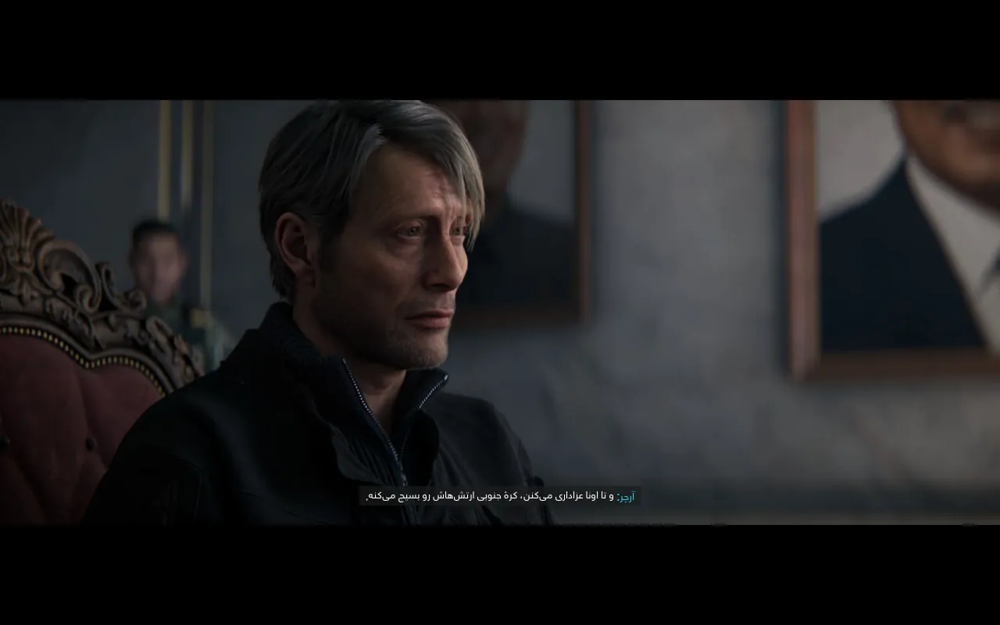
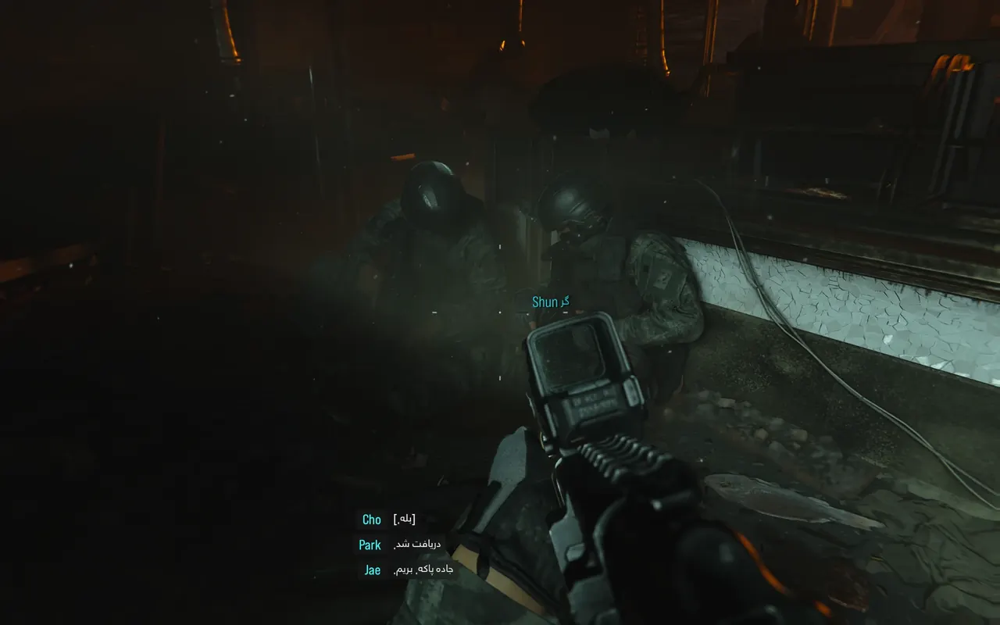
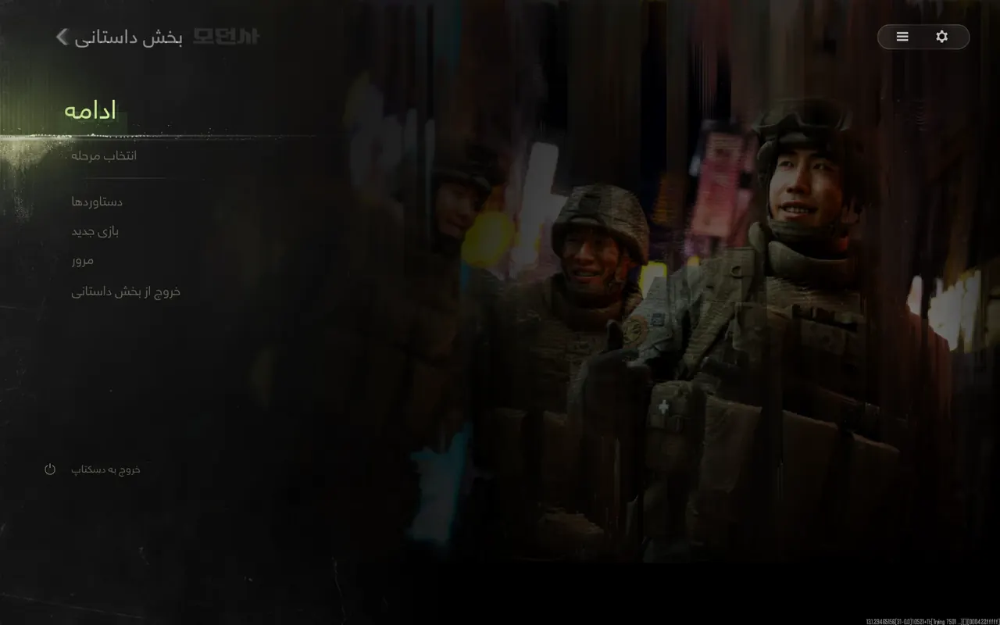
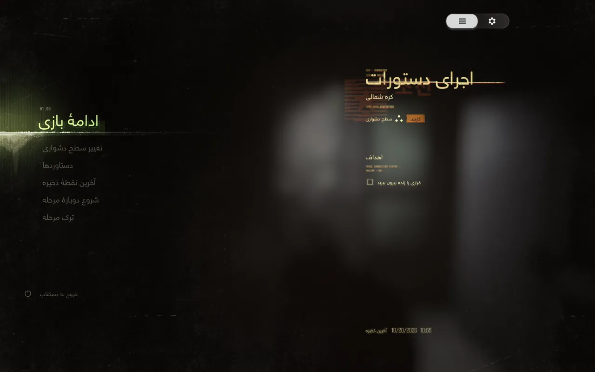

# فارسی‌ساز Call of Duty: Modern Warfare 4

ترجمه و زیرنویس فارسی بخش داستانی **کالاف دیوتی مدرن وارفار ۴**، شامل دیالوگ‌ها، زیرنویس‌ها، اهداف مراحل و منوها، با نمایش راست‌چین.

  
  
  
  

## نصب

1. بازی را ببندید.
2. فایل ZIP را از بخش [Releases](../../releases) دانلود و از حالت فشرده خارج کنید.
3. `install.bat` را اجرا کنید و پوشهٔ اصلی بازی (پوشهٔ حاوی `sp26`) را انتخاب کنید.
4. زبان کیبورد ویندوز را روی **ENG** بگذارید (Alt+Shift). در غیر این صورت نام کلیدها در راهنمای بازی با حروف فارسی نمایش داده می‌شود.
5. بازی را با زبان **English** اجرا و گزینهٔ **Subtitles** را فعال کنید.

برای حذف، `uninstall.bat` را اجرا کنید. فایل‌های اصلی بازی بازگردانده می‌شوند.

## نکات

- فقط برای بخش داستانی و حالت آفلاین. استفاده در بخش آنلاین ممکن است توسط ضدتقلب بازی تشخیص داده شود و به مسدود شدن حساب منجر شود.
- روی بیلد 13.1 بخش تک‌نفره آزمایش شده است. نسخه‌های Steam و Battle.net آزمایش نشده‌اند.
- برخی متن‌های منو و نام شخصیت‌ها ممکن است انگلیسی باقی مانده باشند.
- اگر روی صفحهٔ مرگ راهنمایی به شکل مربع نمایش داده شد، آن را با Issue گزارش کنید.

## نحوهٔ کار

فایل‌های اصلی بازی تغییر نمی‌کنند. ابزار `trhook.dll` هنگام اجرای بازی، متن‌های انگلیسی را با معادل فارسی از فایل `trdata2.bin` جایگزین می‌کند. موتور بازی از خط فارسی پشتیبانی می‌کند و به فونت جداگانه نیازی نیست.

## منبع ابزار

ابزار جایگزینی متن (`trhook.dll` و `bink2w64.dll`) متعلق به [پچ ترکی MW4](https://techolay.net/sosyal/konu/call-of-duty-modern-warfare-4-turkce-yama.222454/) است. در این پروژه داده‌های ترکی با ترجمهٔ فارسی جایگزین شده‌اند. ترجمه مستقیماً از متن انگلیسی بازی انجام شده است.

## گزارش مشکل

در صورت مشاهدهٔ مشکل در ترجمه، یک [Issue](../../issues) باز کنید. فایل‌های ترجمه در پوشهٔ `translations` قرار دارند و فایل نهایی با دستور `python tools/build_trdata.py` ساخته می‌شود.

## مجوز

ترجمه و اسکریپت‌ها تحت مجوز [MIT](LICENSE) منتشر شده‌اند. ابزار هوک متعلق به سازندگان پچ ترکی و متن انگلیسی بازی متعلق به Activision است. این پروژه غیررسمی است و ارتباطی با Activision ندارد.

فارسی ساز کالاف دیوتی · زیرنویس فارسی Modern Warfare 4 · ترجمه فارسی COD MW4 · پچ فارسی کالاف دیوتی ۲۰۲۶ · دانلود فارسی ساز کالاف دیوتی مدرن وارفار ۴ · دانلود زیرنویس فارسی Call of Duty Modern Warfare 4 · دانلود پچ فارسی MW4 · دانلود رایگان ترجمه فارسی کالاف

---

### English

Persian (Farsi) translation for the **Call of Duty: Modern Warfare 4** campaign: subtitles, dialogue, objectives and menus.

**Install:** close the game, run `install.bat`, select the game folder, switch the Windows keyboard layout to English, then launch with the English language and subtitles enabled. Run `uninstall.bat` to restore the original files.

**Campaign / offline only.** Online use may result in an account ban. The runtime hook is from the [Turkish MW4 patch](https://techolay.net/sosyal/konu/call-of-duty-modern-warfare-4-turkce-yama.222454/). Translation licensed under MIT. Unofficial fan project.
